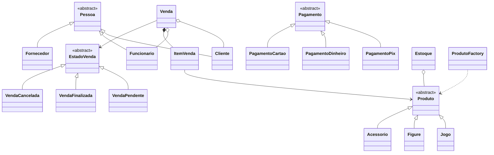

# Loja de Jogos e Colecionáveis (POO + Design Patterns)

Sistema em Python que gerencia uma loja de jogos, figures e acessórios: estoque, clientes,
funcionários, fornecedores e vendas.

## Como executar

```bash
python main.py                                  # demonstração funcional
python -m unittest discover -s tests -t . -v    # testes automatizados
```

Requer Python 3.8+ (sem dependências externas).

## Estrutura

```
main.py            demonstração do sistema
model/             Pessoa, Cliente, Funcionario, Fornecedor, Produto (Jogo/Figure/Acessorio),
                   Estoque, Venda, enums e exceções
factories/         ProdutoFactory
strategies/        Pagamento (Pix, Dinheiro, Cartão)
states/            EstadoVenda (Pendente, Finalizada, Cancelada)
tests/             testes unitários
```

## Pilares da POO

| Pilar | Onde aparece |
|---|---|
| Abstração | `Pessoa` e `Produto` são classes abstratas (`ABC`); `Pagamento` e `EstadoVenda` definem contratos |
| Encapsulamento | atributos privados (`__`) com `@property`; o preço é validado no setter; a quantidade do produto só muda por `baixar_estoque()` / `repor()` |
| Herança | `Cliente`, `Funcionario`, `Fornecedor` herdam de `Pessoa`; `Jogo`, `Figure`, `Acessorio` herdam de `Produto` |
| Polimorfismo | `exibir_dados()` e `exibir_detalhes()` se comportam de forma diferente em cada subclasse; `calcular_valor()` muda conforme a forma de pagamento |

## Design Patterns

- **Factory** (`ProdutoFactory`): cria o produto certo a partir de um `TipoProduto` e valida os dados específicos.
- **State** (`states/estado_venda.py`): a venda muda de `Pendente` para `Finalizada` ou `Cancelada`, e cada estado define o que é permitido.
- **Strategy** (`strategies/`): cada forma de pagamento calcula o valor final (Pix 5% de desconto, crédito parcelado com 3% de juros).

## Regras de negócio

- O estoque é reservado ao adicionar o produto na venda; cancelar a venda devolve o estoque.
- Venda finalizada ou cancelada não aceita novas ações.
- Código de produto duplicado, preço negativo e estoque insuficiente geram erros claros.

## Diagrama de classes



## Declaração de uso de IA
- Neste trabalho foi utilizado a IA para as seguintes finalidades:
 Ajuda na criação das classes.
 Ajuda com organização dos testes e criação das factories.
 Ajuda com correções de erros que ocorriam no decorrer da programação.
 
 ## Declação sobre o único commit
- Foi feito apenas 1 commit pois o trabalho foi feito em 1 dia.